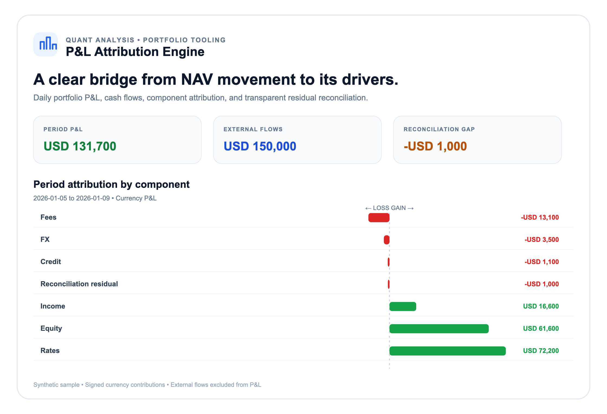
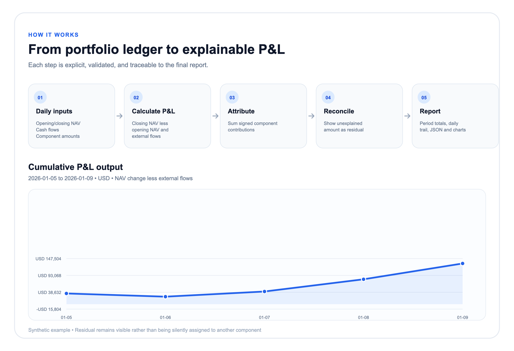

# P&L Attribution Engine

A small, auditable portfolio P&L reconciliation tool. It explains daily and
period-to-date NAV changes using signed attribution amounts, accounts explicitly
for external flows, and exposes any unexplained P&L as a reconciliation
residual. It uses only the Python standard library.

## Attribution identity

For each observation:

```text
portfolio P&L = closing NAV - opening NAV - external flows
portfolio P&L = sum(attribution components) + reconciliation residual
```

Positive external flows are cash entering the portfolio; negative flows are
withdrawals. Component amounts use currency units, with gains positive and
losses/costs negative. The engine does not infer component P&L from security
prices, trades, or market data. It reconciles supplied attribution inputs to
the NAV change and makes any gap visible rather than hiding it.

## Quickstart

Requires Python 3.10 or later.

```bash
python -m pip install -e .
pnl-attribute examples/portfolio.json
pnl-attribute examples/portfolio.json --format json
pnl-attribute examples/portfolio.json --format svg --chart project > reports/project-overview.svg
pnl-attribute examples/portfolio.json --format svg --chart flow > reports/attribution-flow.svg
```

Run tests with:

```bash
python -m unittest discover -s tests -v
```

## Example visuals

These are the two white-background project screenshots, generated from the
included synthetic NAV and attribution data. The project overview includes a
component attribution chart; the workflow view includes the cumulative P&L
chart. PNGs are ready to view and SVGs are scalable source files.





Regenerate the example charts after editing the input:

```bash
mkdir -p reports
pnl-attribute examples/portfolio.json --format svg --chart project > reports/project-overview.svg
pnl-attribute examples/portfolio.json --format svg --chart flow > reports/attribution-flow.svg
```

## Input format

`examples/portfolio.json` provides five illustrative business days and
attribution buckets for equity, rates, credit, income, FX, and fees. Each
observation requires an ISO date, opening NAV, external flows, closing NAV, and
an `attribution` object mapping component names to signed currency amounts.

The engine checks dates, finite numeric values, duplicate dates and component
names, and NAV continuity between consecutive observations. If component
amounts do not explain the full NAV movement, the difference is reported as
`reconciliation_residual`.

## Python API

```python
from pnl_attribution import DailyObservation, PnLAttributionEngine

engine = PnLAttributionEngine(
    currency="USD",
    observations=[
        DailyObservation(
            date="2026-01-05",
            opening_nav=10_000_000,
            external_flows=0,
            closing_nav=10_025_000,
            attribution={"equity": 30_000, "fees": -5_000},
        )
    ],
)

report = engine.run()
print(report.total_pnl)
print(report.component_pnl)
print(report.observations[0].reconciliation_residual)
```

## Scope and limitations

- This is a currency-based P&L bridge, not a return or performance-fee
  calculator. External flows are excluded from P&L; no flow-adjusted return is
  inferred.
- Attribution categories and signed amounts are supplied by the caller. The
  engine does not estimate market, security-selection, carry, or FX effects.
- Period P&L is the sum of daily currency P&L, not a geometrically linked
  percentage return.
- All included sample data is synthetic and for demonstration only.
